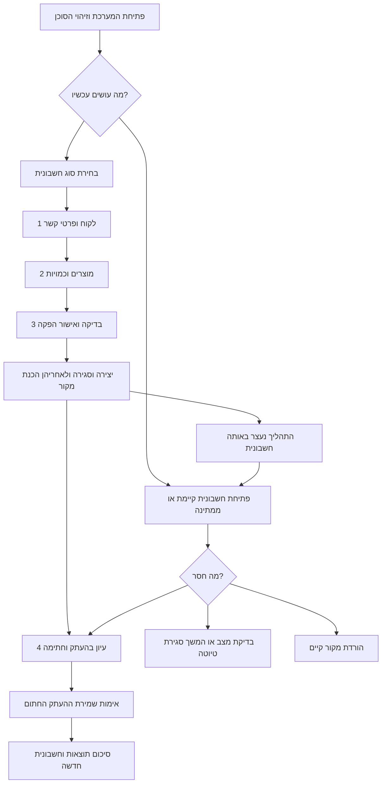

# תכנון מוצר ומסלולי משתמש להפקת חשבוניות

תאריך: 16.11.2026. מצב: הצעת תכנון לפני עיצוב ומימוש.

המשך התכנון: [לוח מסכי המבנה לטלפון ולטאבלט](ux-wireframes/index.html), עם [מפת מסכים והסבר על ההמחשה](ux-wireframes/README.md). הלוח כולל 20 מסכים ותרחישים בנתוני דמה; הוא אינו שינוי במערכת המותקנת.

השלב החזותי: [תצוגת העיצוב בהשראת Apple](apple-design/index.html), עם [עקרונות העיצוב ותוצאות הבדיקה](apple-design/README.md). הכמות, המחיר וההנחה נשארים גלויים באותה שורה גם בעיצוב החדש.

המטרה היא לאפשר לסוכן להפיק חשבונית מול לקוח בטלפון או בטאבלט, להסביר בבירור מה עומד לקרות, לקבל חתימה ולהמשיך ללקוח הבא. הבסיס הקיים מתאים: יש בחירת סוג וארבעה שלבי עבודה. ההמלצה היא לפשט את המידע בכל שלב, להפריד בין מצב החשבונית לבין הורדה, מייל וחתימה, ולתת דרך ברורה להמשיך אחרי תקלה.

המשתמש אישר שעיקר העבודה מתבצע מול הלקוח בטלפון או בטאבלט. יתר ההנחות כאן הן הצעות מוצר שדורשות תיקוף בשימוש אמיתי. לא נערכו ראיונות עם סוכנים ולא נמדדו זמני עבודה בשטח.

## הבסיס שנבדק

- מסכי הכניסה ובחירת הלקוח במערכת שבשרת הקיים, בקריאה בלבד.
- הקוד המקומי של בחירת לקוח, פרטי קשר, שורות מוצרים, חישוב, הפקה, התקדמות, חתימה וחשבוניות אחרונות.
- מעבר מלקוח דרך מוצר ובדיקה ועד למסך החתימה בעותק של הממשק המקומי עם שרת דמה מבודד ונתונים פיקטיביים. לא בוצעו ממנו קריאות ל־Priority או משלוחי דואר.
- תצוגת טלפון בגודל 390×844. זו הדמיית רוחב בדפדפן, ולא בדיקה על מכשיר פיזי או אישור תמיכה ב־Safari ובמקלדת ניידת.

[דו״ח הבדיקה המצולם](ux-audit-2026-11-16/audit.he.md) כולל הבחנה בין תצפיות במערכת הקיימת, תצפיות בהדגמה ומסקנות מקריאת הקוד. שלבי שמירת חתימה והשלמה לא בוצעו בפועל. PDF ההדגמה לא הוצג בתוך המסגרת בדפדפן הבדיקה, ולכן העיון במסמך עצמו נשאר לא מאומת.

## תפקידי המשתמשים

| משתמש | מטרה | מה צריך לראות |
| --- | --- | --- |
| סוכן | להפיק חשבונית נכונה בלי לעכב את השיחה | לקוח, מוצרים, סכום, פעולה הבאה ומצב שמירה |
| לקוח | להבין על מה הוא חותם ולחתום בקלות | העתק החשבונית, שם החותם, אזור חתימה גדול ואישור שמירה |
| עובד שמטפל בתקלה | להשלים פעולה שכבר התחילה | מספר החשבונית, השלב האחרון שאומת והפעולות שמותר להמשיך |

התפקיד האחרון הוא צורך תפעולי מוצע, ולא מערכת הרשאות שכבר קיימת. יש לקבוע מי מורשה לשנות פרטי לקוח ולטפל בפעולות שמצבן לא ודאי.

## מפת המסלול הראשי

הכניסה, התקדמות ההפקה והסיכום הם מצבים סביב ארבעת השלבים, ולא עוד מסכי טופס שחייבים לעבור. אחרי יצירת טיוטה כל פעולת המשך נשארת קשורה אליה. מצב לא ודאי מוביל לבדיקת מצב, לפני ניסיון נוסף לבצע את הפעולה.

## מסלול א — חשבונית חדשה

### כניסה ובחירת סוג

מציגים את הסוכן הפעיל ואת מצב החיבור בשפה ברורה. הפעולה הראשית היא פתיחת חשבונית זהב, יהלומים או תכשיטים בשיבוץ יהלומי מעבדה. לצד יצירה יש כניסה ברורה ל״חשבוניות שלי״ ולפריטים שממתינים להשלמה; זו הרחבה מוצעת של רשימת החשבוניות האחרונה.

קישור סוכן לא תקין מקבל הודעה גלויה עם דרך תיקון, ולא שגיאה שמתגלה רק בתוך ״פרטים נוספים״. בהיעדר סוכן שומרים על ההתנהגות העסקית הקיימת ומבהירים מי יקבע אותו. הקישור הוא מקור למספר הסוכן; הוא אינו הוכחה להזדהות או להרשאה.

### שלב 1 — לקוח ופרטי קשר

**מטרה:** לדעת למי מפיקים ולאמת את הפרטים שנדרשים להמשך.

1. חיפוש לפי שם או מספר ובחירה מפורשת של לקוח.
2. הצגת כרטיס קומפקטי: שם ומספר לקוח, פרטי קשר ומצב מוכנות להפקה.
3. השלמת שדות חסרים בלבד. פרטי חברה מלאים מוצגים בתוך אזור נפתח; חסר שחוסם פעולה מוצג ליד השדה הרלוונטי.
4. אימות שינוי פרטי הקשר ושמירתם. אם נדרש שינוי בכרטיס הלקוח, הפעולה תיקרא ״שמירה והמשך למוצרים״ ותסביר בקצרה אילו נתונים יישמרו. אם אין שינוי ואין צורך בעדכון הגדרות, אפשר להסתפק בהמשך לאחר אימות.

תאריך הוא היום כברירת מחדל. תאריך אחר, מזהה הזמנה, מחסן, איתור ופנקס זמינים בהרחבה, כאשר ערכים ששונו מופיעים גם בסיכום. אין להפוך מזהה הזמנה לחובה לפני החלטה עסקית.

המייל נשאר שדה חובה בהתאם להתנהגות הנוכחית, גם כשלא נבחר משלוח, עד להחלטה עסקית אחרת. אין להסיר דרישה זו כ״שיפור UX״ בלי להבין את מטרתה. הכרטיס צריך להבחין בין שמירת מייל בפריוריטי לבין בחירה לשלוח אליו חשבונית זו.

**יציאה מהשלב:** הלקוח זוהה, הדרישות הנוכחיות מולאו ועדכון שנדרש בכרטיס נשמר ואומת. כשל בשמירה משאיר את הנתונים ואת המשתמש בשלב הזה עם אפשרות ניסיון ממוקדת.

### שלב 2 — מוצרים וכמויות

**מטרה:** לבנות את החשבונית ולראות את משמעות כל שורה מיד.

1. הזנת מק״ט, ברקוד או חיפוש ובחירת מוצר.
2. אישור זיהוי גלוי: שם המוצר והמק״ט. קוד חסר או דו־משמעי אינו הופך למוצר שנבחר.
3. הזנת כמות ביחידה המפורשת של המוצר.
4. הצגת המחיר, ההנחה והסכום לשורה, ואז אפשרות להוסיף מוצר.

בטלפון נשמר מבנה כרטיסי השורות שכבר קיים, עם פחות שטח מבוזבז ופעולות שקל להפעיל באגודל. בטאבלט אפשר לנצל את הרוחב בלי לשנות את סדר הפעולות. סיכום הכמות והסכום לפני מע״מ נשאר נגיש. כפתור ״המשך לבדיקה״ יהיה נגיש באזור פעולות קבוע שאינו מסתיר שדות או את המקלדת.

| סוג חשבונית | התנהגות שנמצאה בקוד המקומי ונשמרת בתכנון |
| --- | --- |
| זהב | כמות בגרמים ומחיר ידני בש״ח לגרם; מק״ט 14 כברירת מחדל |
| יהלומים | מחיר דולר ממחירון הבסיס, כמות לפי יחידת המוצר ושער נעול |
| תכשיטים בשיבוץ יהלומי מעבדה | אותה לוגיקת מחיר ומטבע של מסלול יהלומים, עם סינון מוצרים לסוג המתאים |

במסלולי דולר, בחירת בנק ישראל מוסיפה כיום 2% לשער. המקור, תאריך השער והתוספת צריכים להיות גלויים בלי לחייב פתיחת ההגדרות. אין לשנות את נוסחת המחיר, המטבע או ההנחות במסגרת העיצוב.

הנחה לשורות נשארת ברירת מחדל לשורות שלא נערכו; הנחה שנקבעה ידנית בשורה נשמרת. החלפת סוג עם מוצרים דורשת הסבר על ניקוי השורות. מומלץ לאפשר חזרה מיידית מהפעולה לפני שאובד תוכן, ככל שניתן לממש זאת בלי לשנות את מסמכי Priority.

**יציאה מהשלב:** כל מוצר זוהה, הכמויות והמחירים תקינים והשער הנדרש נטען. שורה בעייתית מקבלת הודעה מקומית ודרך תיקון; לא דורשים מהסוכן להתחיל שוב.

### שלב 3 — בדיקה ואישור הפקה

**מטרה:** לאשר את הפעולה המחייבת מתוך תמונה אחת ברורה.

הסיכום כולל לקוח ומספרו, סוג החשבונית, תאריך, סוכן ומחסן אם נקבעו, שורות עם כמות ויחידה, מחיר, הנחה וסכום, מע״מ וסך לתשלום. הסכומים לפני ההפקה מסומנים כתצוגה מקדימה; אחרי ההפקה מציגים את הסכום שהוחזר מפריוריטי.

בחירת המשלוח מקבלת אזור ברור: ״הורדת מקור למכשיר״ ו״שליחת המקור גם למייל״, עם הנמען המדויק והאפשרות לערוך. המצב שנבחר בשלב הלקוח, אם נשארת שם אפשרות המייל, חייב להשתקף כאן. ההודעה והכפתור נגזרים מאותה בחירה.

- ללא מייל: ״הפקת חשבונית והורדת מקור״.
- עם מייל: ״הפקת חשבונית ושליחת מקור״; תיאור סמוך מבהיר שגם תתבצע הורדה.

מציגים בסמוך שהפעולה יוצרת וסוגרת חשבונית סופית. לא מוסיפים חלונית אישור נוספת באופן אוטומטי אחרי מסך בדיקה מפורש. קישורי ״עריכה״ מחזירים לשלב המתאים עם כל הנתונים.

**יציאה מהשלב:** לחיצה מכוונת אחת מתחילה ניסיון הפקה יחיד. לחיצה כפולה, ניתוק או חזרה למסך אינם סיבה ליצירת חשבונית נוספת.

### במהלך ההפקה

מציגים את השלב שאומת בפועל: יצירה, סגירה, הכנת מקור והכנת העתק. זמינות הורדה, קבלת בקשת המייל וחתימה הן תוצאות נפרדות. אין להציג ״נמסר ללקוח״ רק כי שרת הדואר אישר בקשת שליחה או שהדפדפן קיבל בקשת הורדה.

חלון ההתקדמות הקיים נותן משוב ומונע סגירה מקרית, אבל אין בו מסלול ברור להמתנה ממושכת. מוצע להוסיף חיווי על השלב האחרון שאומת ופעולת ״בדיקת מצב״ בטוחה, לאחר שקיימת תמיכת שרת לכך. עד אז אין להציג כפתור שמבטיח יכולת שאינה קיימת.

### שלב 4 — עיון וחתימה

**מטרה:** להעביר את המסך ללקוח בלי לערבב פעולות תפעוליות עם החתימה.

1. הצגת מספר החשבונית והעתק קריא, עם פתיחה נפרדת אם התצוגה המוטמעת אינה זמינה.
2. שם החותם ואזור חתימה בגובה שימושי. יעד התכנון הראשוני הוא לפחות 180–220 פיקסלי CSS בטלפון, שייבדק על מכשירים אמיתיים.
3. ״ניקוי חתימה״ ו״שמירת חתימה״. השמירה הופכת לזמינה אחרי מילוי השם וציור חתימה.
4. שמירה ואימות ההעתק החתום בנספחי אותה חשבונית.

בזמן החתימה מורידים מהמסך הודעות היסטוריות שחוזרות על שלבי ההפקה, ומשאירים תקציר סטטוס נגיש לסוכן. הודעות מייל אינן מסתירות את אזור החתימה. כשל שמירה משאיר את הציור והשם על המסך ונותן אפשרות ניסיון ממוקד לאחר בדיקת המצב.

יציאה לפני שמירה נקראת ״סיום ללא חתימה כרגע״ ומבהירה שהחשבונית קיימת וממתינה להשלמה. רק לאחר שתהיה יכולת חזרה אמינה, אפשר להציע פעולה זו לצד ״חזרה לחתימה״. נדרש להחליט מי רשאי לדלג על חתימה.

### סיום

אחרי שמירה מאומתת מציגים מספר חשבונית וסיכום נפרד לכל תוצאה: סופית, מקור זמין, הורדה התבקשה, מצב בקשת המייל והעתק חתום שמור. פעולה ראשית: ״חשבונית חדשה״. פעולות משניות: עיון בהעתק חתום והורדה חוזרת של מקור קיים.

אם חלק מהתהליך לא הושלם, מציגים ״החשבונית הופקה — נותר להשלים…״. אין להפוך חתימה מוצלחת לאישור שמייל נמסר.

## מסלול ב — המשך טיפול בחשבונית קיימת

1. כניסה ישירה ל״חשבוניות שלי״ או ל״ממתינות להשלמה״, גם בלי להתחיל חשבונית חדשה ולבחור סוג.
2. איתור לפי מספר חשבונית או לקוח, ככל שההרשאות מאפשרות. הרחבת החיפוש והרשימה מעבר לעשר האחרונות דורשת תמיכת שרת והגדרת היקף.
3. הצגת מצב אמיתי של כל תת־פעולה, ולא רק ״טיוטא״ או ״סופית״.
4. הצעת הפעולה הבאה המתאימה: בדיקת מצב, המשך סגירת הטיוטה הקיימת, הורדת מקור קיים או השלמת חתימה.

הרשימה הנוכחית במסך הכניסה היא לקריאה בלבד. פעולות המסמכים זמינות רק ברשימת הלקוח שבתוך טופס החשבונית. ברשימת הסוכן נכללות חשבוניות לפי קוד סוכן, בעוד שפעולות מסוימות דורשות שהחשבונית תהיה בטיפול משתמש ה־API. לכן לא מוסיפים לכל רשומה כפתורי פעולה בלי לבדוק זכאות בצד השרת.

## התנהגות במצבי תקלה

| מצב | מה המשתמש רואה | הפעולה הבאה | כלל מערכת |
| --- | --- | --- | --- |
| אין חיבור לפני ההפקה | ״לא ניתן להתחבר לפריוריטי כרגע״ | ניסיון חיבור מחדש | שימור קלט שכבר הוזן; לא מציגים הצלחה |
| פרטי לקוח חסרים | השדות החסרים והסיבה לעצירה | השלמה ושמירה | אין יצירת חשבונית לפני בדיקות נדרשות |
| שמירת לקוח נכשלה | ״הפרטים לא נשמרו״ | ניסיון שמירה ממוקד | לא עוברים שלב על סמך נתונים שלא אומתו |
| מוצר לא מזוהה | ההקשר של השורה והצעות מתאימות | תיקון קוד או בחירה | אין הוספת מוצר שגוי אוטומטית |
| מחיר או שער חסר | המקור שחסר והדרך לתקן | טעינה מחדש או טיפול בפריוריטי | אין מעבר אוטומטי למקור תמחור אחר |
| מזהה הזמנה קיים | מספר ומצב החשבונית שנמצאה | פתיחתה לבדיקה | אין הנחיה לעקוף מניעת כפילות באמצעות שינוי טקסט בלבד |
| יצירה לא ודאית | ״בודקים אם החשבונית כבר נוצרה״ | בדיקת אותו ניסיון | שומרים מזהה ניסיון ואת ההקשר שלו |
| טיוטה נוצרה, סגירה לא אומתה | מספר הטיוטה והשלב האחרון שאומת | בדיקת מצב, ואז המשך אם מותר | אין יצירת טיוטה חדשה |
| מקור לא הוכן | החשבונית סופית; מצב המקור נפרד | בדיקת נספח או מצב הכנה | אין הפקת מקור מחדש במצב לא ודאי |
| הורדה נחסמה | ״המקור מוכן; ההורדה לא אושרה״ | הורדת הקובץ הקיים | אין הפקה חדשה או שליחת מייל אוטומטית |
| מייל לא ודאי | מצב בקשת השליחה והנמען | בדיקת מצב אצל מטפל מורשה | אין שליחה חוזרת אוטומטית |
| חתימה לא נשמרה | הציור נשאר, השמירה לא אומתה | בדיקת מצב והמשך שמירה | אין יצירת חשבונית נוספת |
| רענון או חזרה לאפליקציה | פרטי העבודה שנשמרו ושלב מאומת | המשך באותו תהליך | שימור עבודה ושחזור הם יכולת חדשה נדרשת |

## עקרונות Apple לשלב העיצוב הבא

בונים על `public/apple-design.css` הקיים. התכנון אינו מחייב להחליף את הממשק או את טכנולוגיית הפרונטאנד.

- פעולה ראשית אחת לכל שלב והיררכיה ברורה בין פעולה, מידע ועזרה.
- גילוי הדרגתי: פרטי לקוח תקינים מתקפלים; מידע שחוסם פעולה מופיע במקום שבו ניתן לתקנו.
- תגובה מיידית ללחיצה וחיווי מתמשך לבקשות. תנועה קצרה שמסבירה מעבר, עם תמיכה בהפחתת תנועה.
- גודל מגע שימושי, טיפוגרפיה קריאה בעברית ו־RTL עקבי, עם בידוד מספרים, מק״טים וסכומים.
- רציפות: חזרה לשלב שומרת נתונים; חזרה מתקלה מחזירה לאותה חשבונית.
- אזור פעולות קבוע, בכפוף לבדיקה מול מקלדת ניידת, אזור בטוח בתחתית וגלילה. אין לכסות את השדה הפעיל.
- מסך חתימה שמרגיש מוכן להעברה ללקוח, כולל חלופה נגישה למי שאינו יכול לצייר חתימה. אופן החלופה דורש החלטה עסקית.

נגישות מלאה לא נבדקה. נדרשות בדיקות VoiceOver/TalkBack, ניווט מקלדת, סדר מוקד, חיפוש לקוח ומוצר, ניגודיות, הגדלת טקסט, גלילה ואוריינטציה. חיפוש הלקוחות כיום מבוסס פריטי `div` בלי סמנטיקה מלאה של רשימת בחירה; אין להסיק מהצלחת בחירה במקלדת שהוא נגיש לקורא מסך.

## סדר העבודה המוצע

| סדר | תוצר | תנאי סיום |
| --- | --- | --- |
| 1 | סגירת החלטות מוצר ומצבי התהליך | כל שדה נדרש, פעולת שמירה ותוצאת הפקה מוגדרים; אין סתירה במייל |
| 2 | מסכי מבנה לטלפון ולטאבלט | מסלול חדש, מסלול המשך, חתימה ומצבי כשל מיוצגים לפני ליטוש חזותי |
| 3 | כיוונים חזותיים בהשראת Apple | בחירת כיוון על בסיס המבנה והמסכים הקיימים |
| 4 | אב־טיפוס עם נתוני דמה | מעבר מלא, עריכה לאחור, מחירים לפי סוג ותרחישי כשל פועלים |
| 5 | מימוש מדורג במערכת הקיימת | תחילה ניסוחים וניווט; לאחר מכן שמירת מצב, חזרה לתהליך ושיפור חתימה |
| 6 | בדיקת קבלה במכשירים אמיתיים | שימוש מול לקוח, מסמך קריא, חתימה נוחה, ושחזור בלי כפילויות |

בדיקות הקבלה למימוש יכללו שלושת סוגי החשבונית, כשל שמירת לקוח, מוצר דו־משמעי, מחיר ושער חסרים, כפל לחיצה, ניתוק אחרי יצירה, מקור לא ודאי, הורדה חסומה, מייל לא ודאי וכשל שמירת חתימה. פעולות Priority ומייל אמיתיות ייבדקו בנפרד מההדגמה ובהיקף שיאושר לבדיקת הקבלה.

## החלטות עסקיות שנותרו לפני מימוש

1. האם המייל נדרש גם ללא משלוח, והאם משלוח יישאר מסומן מראש או ידרוש בחירה לכל חשבונית? ההמלצה היא בחירה גלויה ואישור הנמען במסך הבדיקה, בלי לשנות כרגע את ברירת המחדל בקוד.
2. האם מותר לסיים ללא חתימה ומי רשאי להשלים או לעקוף אותה? בכל מקרה יש להציג שמדובר בחשבונית קיימת שממתינה לפעולה.
3. מי רשאי לעדכן כרטיס לקוח ולטפל במייל או בהפקה שמצבם לא ודאי?
4. באילו מכשירים ודפדפנים משתמשים בפועל, והאם ברקוד מוזן בסורק מקלדת? סריקת מצלמה אינה יכולת קיימת שנכללת אוטומטית בתכנון.

## גבולות והערות למימוש

ה־README משלב תיאורים מתקופות שונות: מחיר זהב אוטומטי בדולר לעומת הזנה ידנית בש״ח שנמצאה בקוד המקומי, וסגירה ידנית לעומת רצף הסגירה הנוכחי. יש לאחד את התיעוד לפני מימוש, לאחר אימות התנהגות השרת המותקן. אין להחזיר לוגיקה ישנה מתוך התיעוד תוך כדי עיצוב.

שמירת תהליך מתמשך דורשת יותר מ־CSS: מזהה ניסיון, קישור בין טיוטה לחשבונית סופית, מצבי מקור, דואר וחתימה וממשק קריאה מורשה למצבים האלה. כיום נשמר מזהה יצירה ב־sessionStorage, וקיימים מצבים מתמידים בשרת, אך לא נמצא בפרונטאנד מסלול שחזור מלא לאחר רענון. אין לאחסן PDF, ציור חתימה או פרטי לקוח רגישים בדפדפן כחלק מהפתרון בלי להגדיר צורך ומדיניות.

לא שונו קובצי המוצר, פרטי לקוחות, חשבוניות או הגדרות Priority במסגרת התכנון. קובצי התיעוד והדגמת ה־UX נוספו לפרויקט. הצעד הבא הוא הכנת מסכי המבנה על בסיס המסלולים האלה, לפני בחירת הכיוון החזותי.

## עדכון עגלת מוצרים — 16.11.2026

לפי בקשת המשתמש, ההנחה הגורפת גלויה מעל ומתחת למוצרים ושני השדות מסונכרנים. שינוי גורף מחליף את ההנחות של כל השורות הקיימות, כולל שינויים פרטניים קודמים; שורות חדשות יורשות את ההנחה הנוכחית. לאחר השינוי הגורף עדיין ניתן לערוך הנחה לשורה בודדת. כלל זה מחליף את ההנחיה הקודמת לשמור חריגות פרטניות כאשר משנים הנחה גורפת. שער דולר משותף מוצג פעם אחת; סיכום החשבונית מופיע אחרי רשימת המוצרים. [פירוט ואימות](apple-design/cart/README.md).
