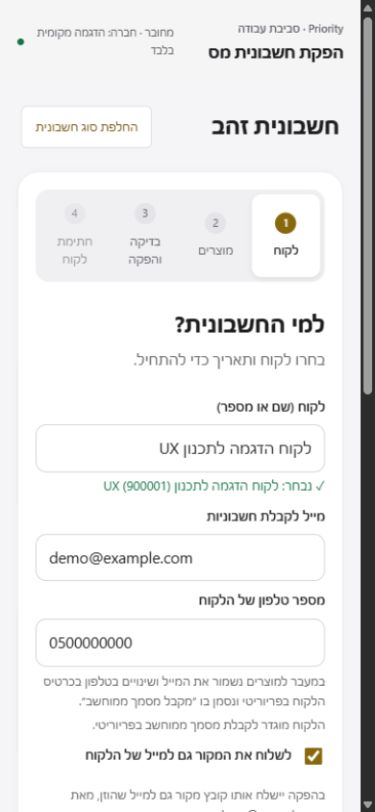
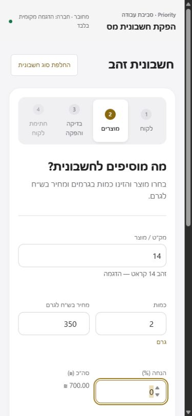
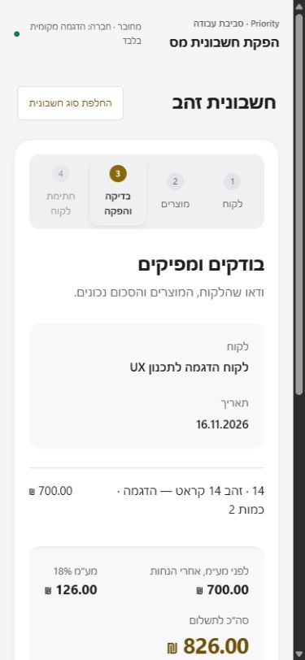
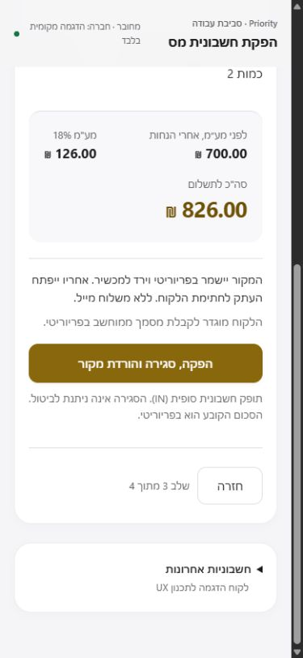
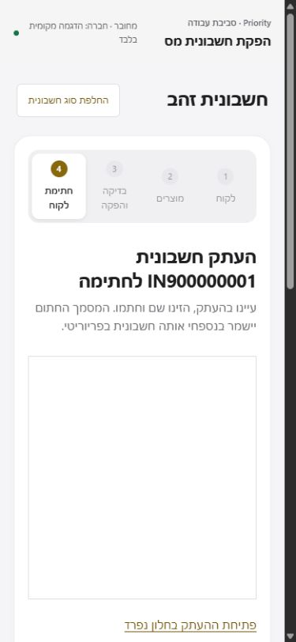
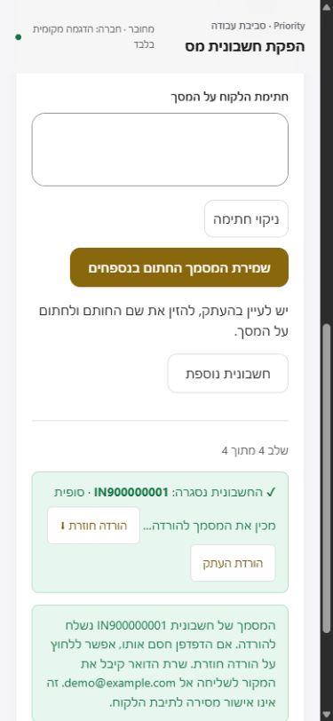
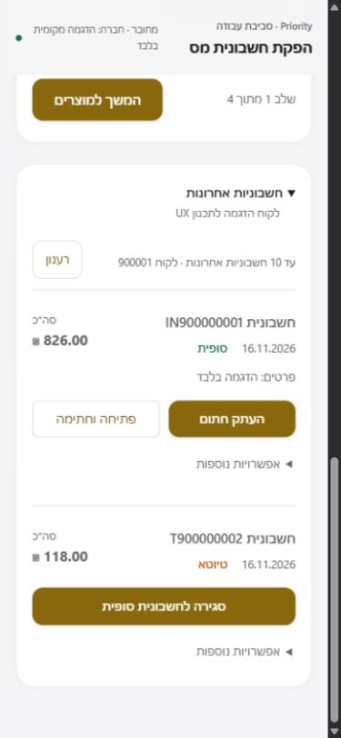

# בדיקת חוויית המשתמש במסלול הפקת חשבונית

16.11.2026 · מיקוד: סוכן מול לקוח בטלפון או בטאבלט.

המערכת כבר מחולקת לארבעה שלבים ובנויה לעבודה בעברית. השיפורים החשובים הם בהירות הפעולות שנשמרות, עקביות המייל, נוחות חתימה וחזרה לחשבונית קיימת אחרי תקלה. [תוכנית המוצר והמסלולים](../product-ux-plan.he.md) מפרטת את הפתרון המוצע.

## היקף ואופן הבדיקה

הכניסה ובחירת הלקוח נבדקו במערכת הקיימת בשרת המשרד, ללא כתיבה. כדי לעבור את השלב ששומר פרטי לקוח ולבחון את מסכי ההמשך, הופעל `preview.cjs` שמגיש את קובצי `public/` המקומיים עם תשובות דמה בלבד. הוא אינו טוען `.env`, אינו מתחבר לפריוריטי ואינו שולח מייל. כל הלקוחות, הסכומים ומספרי המסמכים בצילומי ההדגמה פיקטיביים.

מסך הדמה אינו מוכיח שהשרת המותקן זהה לקוד המקומי או שפעולות ERP ומייל יצליחו. הצילומים נפתחו ונבדקו בזמן הריצה. טלפון נבדק בגודל 390×844 בדפדפן; לא נבדקו מכשיר פיזי, מקלדת מסך, טאבלט או דפדפני מובייל אמיתיים. לא בוצעו שמירת חתימה והשלמת תהליך.

חלון ההתקדמות ומצבי הכשל נסקרו בקוד; לא נשמר עבורם צילום יציב ולא הוזרקו תקלות רשת. תרחישי כשל בתוכנית הם דרישות למימוש ולבדיקות הבאות, ולא תוצאות של בדיקות קבלה שבוצעו עכשיו.

## 1 — כניסה ובחירת סוג

**מצב: בסיס טוב.** שלוש אפשרויות מפורשות ומצב חיבור גלוי. רשימת הסוכן נמצאת בהמשך העמוד, אך אין ממנה פעולות המשך ישירות. הכניסה ממשיכה להדגיש יצירה חדשה גם כאשר הסוכן צריך לחזור למסמך קיים.

המלצה: לשמור את בחירת הסוג ולהוסיף כניסה מפורשת לחשבוניות ולהשלמות. נגישות: הכפתורים מתוארים בטקסט ואינם תלויים באייקון בלבד; ניגודיות מלאה לא נמדדה.

צילום מהמערכת הקיימת, לפני בחירת לקוח:

## 2 — שלב הלקוח

**מצב: ברור לפני בחירה, עמוס אחריה בנייד.** חיפוש שם או מספר, תאריך ומזהה הזמנה מסודרים. לאחר בחירה מתווספים פרטי קשר, הגדרות דיגיטליות, משלוח ופרטי חברה. בהדגמה ברוחב טלפון נמדד כפתור ההמשך סביב 1,496 פיקסלים מראש הדף, כשהמסך בגובה 844 פיקסלים.

לחיצה על ״המשך למוצרים״ מפעילה שמירת כרטיס לקוח דרך `saveCustomerDelivery()`. הכיתוב הקטן מסביר זאת, אך שם הפעולה אינו מבהיר את השמירה. גם ללא משלוח מייל, שדה המייל נדרש. אפשרות משלוח המייל מסומנת מראש כאשר שירות הדואר מוגדר.

המלצה: כרטיס לקוח קומפקטי, הרחבת פרטים לפי צורך, חיווי מוכנות ו״שמירה והמשך״ כאשר מתבצע עדכון. נגישות: בחירה במקלדת נצפתה, אך רשימת לקוחות מבוססת `div` אינה מספקת בפני עצמה סמנטיקה של combobox/listbox.

צילום מהמערכת הקיימת במצב ריק:

צילום טלפון מההדגמה עם פרטים פיקטיביים:

## 3 — מוצרים וכמות

**מצב: מבנה שימושי, דורש הידוק למובייל.** בטלפון השורה הופכת לכרטיס עם שדות קריאים; אין צורך להמציא מבנה חדש. הוזנו 2 גרם במחיר 350 ש״ח לגרם, והסכום לפני מע״מ הוצג כ־700 ש״ח. זיהוי מק״ט ברירת המחדל אומת מול תשובת הדמה.

בקוד המקומי זהב מתומחר ידנית בש״ח, בעוד שה־README עדיין מתאר גם מסלול ישן בדולרים. במסלולי יהלומים ותכשיטי מעבדה המחיר ממחירון הבסיס והשער נעול; תוספת 2% לשער בנק ישראל מופיעה בהגדרות הנפתחות. מסלולי דולר נסקרו בקוד ולא בוצע להם מעבר מלא בדפדפן.

המלצה: יחידה ומקור מחיר גלויים, סיכום נגיש ופעולת המשך זמינה. נגישות: יש שמות לשדות, אך כפתור המחיקה מוצג כ־✕ ושדה ההנחה חוזר בכל שורה בלי הקשר מפורש למוצר בשם הנגיש.

## 4 — בדיקה ואישור הפקה

**מצב: הסכום ברור, בחירת המשלוח אינה משתקפת.** ההדגמה הציגה 700 לפני מע״מ, 126 מע״מ ו־826 לתשלום. לא מוצגים בסיכום פרטי המייל, הטלפון, הסוכן והמחסן, וגם אין יחידת כמות מפורשת בכל שורת הסיכום.

הסתירה החשובה: האפשרות לשלוח למייל נבחרה, אך הסיכום קובע ״ללא משלוח מייל״. בהמשך אותו תהליך דמה אכן נצפתה קריאה לנתיב המייל של שרת הדמה. לכן לא מדובר רק בתיעוד מיושן.

המלצה: להציג נמען ומצב משלוח לפי הבחירה בפועל ולנגזר מאותה בחירה את הטקסט ואת הפעולה. נגישות: סכומים מסומנים בכותרות טקסט, אך פרטי המשמעות והפעולה נמצאים בהמשך גלילה.

## 5 — חתימת לקוח

**מצב: נדרש שיפור שימושיות ואימות מסמך במכשיר אמיתי.** המעבר למסך החתימה נצפה לאחר תגובות היצירה, הסגירה והמקור בשרת הדמה. לא נוצרה חשבונית אמיתית.

אזור החתימה נמדד בכ־301×86 פיקסלי CSS. קנה המידה נובע מ־canvas בגודל 640×180 שמוקטן לפי רוחב. לצד פעולות החתימה נשארות הודעות קודמות על סגירה והורדה. הכפתור ״חשבונית נוספת״ מאפשר יציאה לפני שמירת החתימה לאחר אישור, לפי הקוד; אין במסך זה סיכום מתמיד של משימה שממתינה להשלמה.

מסגרת ה־PDF נשארה לבנה בסביבת הבדיקה, אף שקיים קישור לפתיחה בנפרד. צילום 07 מתעד את החסימה ואת מבנה המסך בלבד; הוא אינו ראיה להצגת מסמך תקינה או לתקלה במערכת המותקנת. הצגה בפועל של העתק אמיתי נותרה לבדיקה.

המלצה: אזור חתימה גבוה, עיון נגיש במסמך, שם ופעולה ברורים, ויציאה שמבהירה את מצב החתימה. נגישות: ציור על canvas דורש חלופה עסקית מוגדרת למי שאינו יכול לצייר; השמירה צריכה להסביר תנאים חסרים עוד לפני הלחיצה.

## 6 — חשבוניות קיימות

**מצב: פעולות קיימות, הגישה מסורבלת.** ברשימת הלקוח קיימים ״העתק חתום״, ״פתיחה וחתימה״ והורדות נוספות. טיוטה מקבלת פעולה לסגירה. הרשימה נמצאת בתחתית מסך היצירה, בעוד שרשימת הסוכן במסך הראשי אינה מציעה פעולות אלה.

כל חשבונית סופית מקבלת כפתור ״העתק חתום״ גם בלי שהרשימה מציגה אימות לקיום נספח חתום. המצב ״סופית״ אינו אומר אם הורדה, מייל וחתימה הושלמו. בדיקה זו פתחה את הרשימה בלבד, ולא הפעילה פעולות מסמך אמיתיות.

המלצה: כניסה ישירה למסמכים, מצבים לפי תת־פעולה והצגת הפעולה הבאה שמתאימה למצב ולהרשאות. נגישות: קבוצות פעולות משויכות למספר חשבונית, אך יש לבדוק ניווט וקורא מסך לאחר שינוי רשימה.

## 7 — השלמה וחזרה לאחר תקלה

**מצב: נסקר בקוד בלבד; לא נבדק מקצה לקצה.** `completeSignatureFlow()` מחזיר לבחירת סוג ומציג שההעתק החתום נשמר ואומת. השרת שומר מצבים ומזהה ניסיון מסייע במניעת כפילות, אך לא נמצא מסלול פרונטאנד מלא לשחזור העבודה לאחר רענון. הטופס מאפס שורות לאחר קבלת מספר טיוטה, עוד לפני השלמת סגירה, מקור וחתימה.

המלצה: סיכום תוצאות נפרדות ומסלול חזרה לאותו תהליך. נדרש צילום ובדיקת קבלה של הצלחה ושל תקלות אחרי מימוש, עם מקור, מייל וחתימה בפועל בהיקף מוסכם. אין כאן אישור נגישות, מהימנות תפעולית או מסירת מייל.

## סדר עדיפויות

1. עקביות משלוח: בחירה, נמען, הודעת הסיכום ותוצאת השליחה.
2. שימור הקשר החשבונית ודרך המשך לאחר כשל או יציאה ללא חתימה.
3. קיצור שלב הלקוח והבהרת שמירה בכרטיסו.
4. הגדלת אזור החתימה והפרדת תצוגת הלקוח מהודעות הסוכן.
5. ליטוש השפה הקיימת בהשראת Apple לאחר סגירת המבנה.

## שחזור ההדגמה

מריצים משורש הפרויקט `node docs/ux-audit-2026-11-16/preview.cjs`, ופותחים את `http://127.0.0.1:18474/?agent=90`. נתוני הדמה זמינים רק בתהליך הזה, ללא שרת המוצר וללא גישה חיצונית. ההדגמה מגישה את קובצי הממשק כפי שיהיו בזמן ההרצה; הצילומים כאן הם התיעוד של מצב 16.11.2026. יצירה וסגירה מדומות, ונתיב שמירת חתימה אינו מופעל. לעצירה משתמשים ב־Ctrl+C. אין להציג את תוצאות הדמה כהוכחה לבדיקת Priority.
